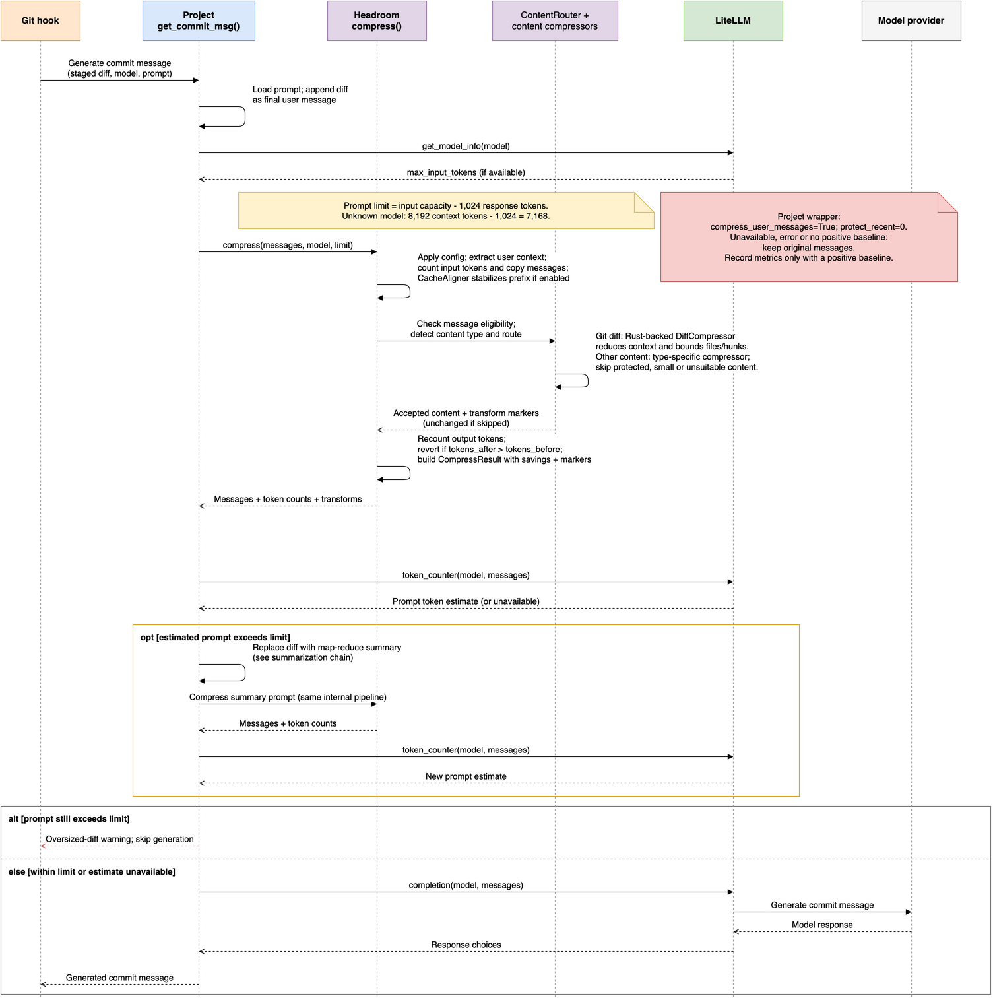

# Headroom prompt compression

The hook uses Headroom's Python library to compress prompts before sending them through LiteLLM.
Compression can reduce token use and help large diffs fit within the model's context window.
The hook attempts compression automatically,
but it can still generate a commit message when compression is unavailable or fails.

## Why the project uses it

The prompt contains the commit-message instructions and the staged Git diff.
Large diffs often contain repeated headers and context lines.
Headroom can remove some of that repetition while retaining information about the changes.

The project still owns the final size check.
Headroom reduces the prompt;
it does not guarantee that every prompt fits the model's context window.

The project calls Headroom directly.
It does not run a Headroom proxy or provide retrieval tools to the model.
Headroom can internally cache original content and emit Compress-Cache-Retrieve (CCR) markers,
but this integration does not let the model retrieve omitted content.

## How the integration works

The hook loads the configured prompt,
adds the commit-message format instruction,
and appends the staged diff as the final user message.
It passes these messages to `headroom.compress.compress()`.

Headroom examines the content and selects a suitable compressor.
Git diffs can use a diff-specific compressor;
other supported content types include JSON, logs, tables, configuration, and plain text.

The hook sets `compress_user_messages=True` and `protect_recent=0`
so the final user message containing the diff is eligible for compression.
It also passes Headroom the prompt token limit described below.

Headroom returns the resulting messages,
input and output token counts,
and the transforms it applied.
The hook records compression metrics only when the input token count is positive (`tokens_before > 0`).

## Prompt token limit

The hook reads `max_input_tokens` from `litellm.get_model_info()`.
It does not use LiteLLM's `max_tokens` value,
because that value can describe the model's output limit rather than its input capacity.

The hook reserves 1,024 tokens for the generated response.
For example,
a model with a 128,000-token maximum input size receives a 126,976-token prompt limit.
If metadata lookup fails or returns no valid positive input limit,
the hook uses an 8,192-token fallback.
After reserving response tokens,
this leaves a 7,168-token prompt limit.
The fallback supports models accessed through custom gateways or proxy aliases,
but it is not a guarantee of the provider's actual limit.

## Compression sequence



Source: [Editable draw.io diagram](../assets/diagrams/headroom-sequence.drawio).

The diagram separates Headroom's compression work from the hook's size check and model request.
It summarizes `headroom-ai` 0.40.0,
the version recorded in this repository's [lockfile](../../uv.lock).
The package dependency is unpinned,
so installations can resolve a different version with different internal behavior.

Within Headroom:

- Compression options determine which messages are eligible.
- The pipeline extracts user context and counts the input tokens.
- When enabled, `CacheAligner` stabilizes the prompt prefix to support provider caching.
- `ContentRouter` selects a compressor for eligible content.
- For Git diffs, the Rust-backed `DiffCompressor` reduces context and limits the number of files and hunks.
- Headroom counts the output tokens and restores the original messages if compression increases the count.

The diagram groups the router and compressors into one participant
and omits optional hooks and telemetry.

## When the prompt is still too large

After compression,
the hook asks LiteLLM to estimate the prompt's token count.
If the estimate exceeds the prompt limit,
the hook replaces the diff with a [map-reduce summary](summarization-chain.md),
then compresses and measures the prompt again.
If the new estimate still exceeds the limit,
the hook skips commit-message generation and returns a warning.

Token estimation is a safeguard,
not a requirement for generation.
If LiteLLM cannot estimate the token count,
the hook proceeds with the model request.
The provider can still reject a prompt that exceeds its limit.

## What compression can remove

Compression can be lossy:
the result may not contain every line of the original diff.
The diff-specific compressor aims to retain useful patch structure,
added and removed lines,
and relevant context.
However,
limits on files and hunks can omit parts of a large change.
The project does not guarantee a fixed compression ratio or complete preservation of the diff.

## Fallback behavior

If Headroom is unavailable,
raises an exception,
or returns a nonpositive input token count,
the hook keeps the original messages.
Headroom can also leave content unchanged when it is too small,
unsuitable for compression,
or unlikely to save tokens.

A compression failure therefore does not block generation by itself.
The hook still attempts the token estimate and oversized-prompt handling described above.

## Compression metrics

The CLI reports compression metrics when they are available:

```console
Headroom: 2395 -> 2131 prompt tokens over 1 request(s); saved 264 (11.0%).
```

Here,
compression reduced the prompt from 2,395 to 2,131 tokens,
saving 264 tokens (11.0%).
The CLI aggregates metrics from compression calls in the current process;
`request(s)` counts those calls,
not model-provider requests.
The savings describe this run,
not what every diff will achieve.

## Further reading

For Headroom's current compression pipeline,
including content routing and safety gates,
see [How compression works](https://docs.headroomlabs.ai/docs/how-compression-works).
For its supported entry points and the distinction between the inline library, proxy, and CCR flows,
see [Headroom architecture](https://docs.headroomlabs.ai/docs/architecture).
For the implementation summarized in the diagram,
see Headroom 0.40.0's [inline API](https://github.com/headroomlabs-ai/headroom/blob/v0.40.0/headroom/compress.py),
[transform pipeline](https://github.com/headroomlabs-ai/headroom/blob/v0.40.0/headroom/transforms/pipeline.py),
and [diff compressor](https://github.com/headroomlabs-ai/headroom/blob/v0.40.0/headroom/transforms/diff_compressor.py).

## Related topics

- [How the hook works](how-it-works.md) explains the complete commit-message flow.
- [Large diff summarization chain](summarization-chain.md) explains how the hook summarizes oversized diffs.
