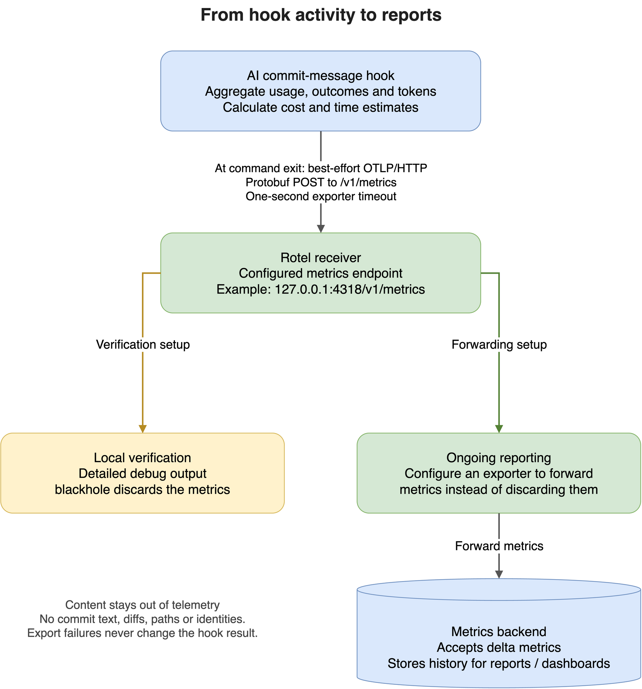
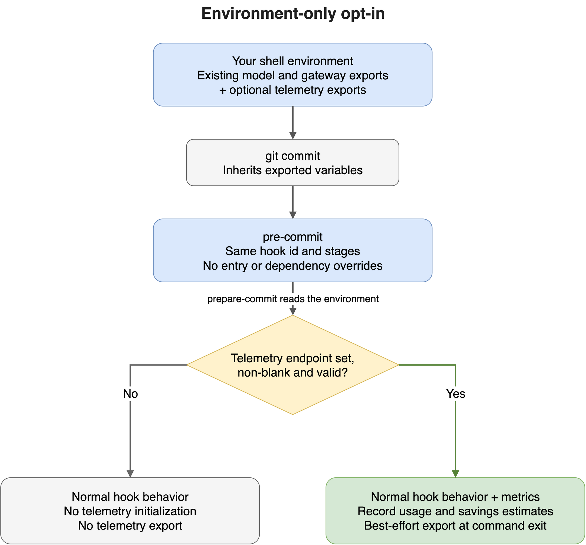
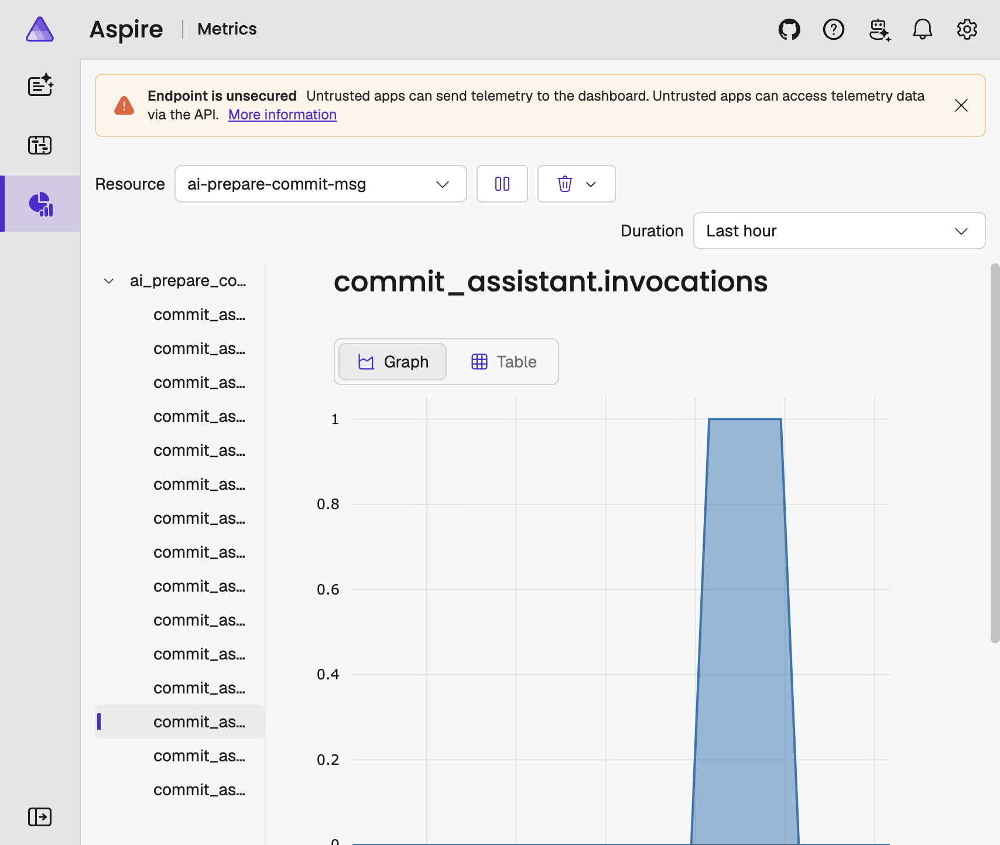
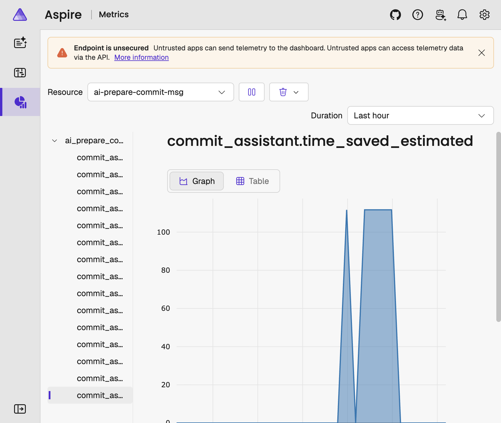

# Track usage and AI savings

Use this guide to send hook usage and savings metrics to an
OpenTelemetry Protocol over HTTP (OTLP/HTTP) receiver.
Telemetry is optional and disabled by default.
Telemetry support is available starting with version `20.8.0`.



Source: [Editable draw.io diagram](../assets/diagrams/telemetry-delivery.drawio).

The local verification setup prints and discards metrics.
To keep historical reports,
configure Rotel to forward metrics to a backend.

## Prerequisites

- An [installed hook](how-to-install.md) and a configured model.
- Version `20.8.0` or later of the package.
- An OTLP/HTTP metrics receiver, such as [Rotel](https://github.com/rotel-dev/rotel).
- Docker, only if you choose the container option below.

The receiver URL is not a dashboard URL or a Prometheus scrape endpoint.
Your receiver must accept binary OTLP metrics.

## 1. Prepare a receiver

For an existing receiver,
obtain its full metrics URL and any required authentication headers.
Use HTTPS for remote receivers.

For lightweight local collection,
use Rotel, a Rust-based OpenTelemetry collector with an OTLP/HTTP metrics receiver.
Choose the native binary to avoid a container runtime,
or use the Docker option below.

### Native binary

Download the binary for your operating system and architecture from the
[Rotel releases](https://github.com/rotel-dev/rotel/releases),
and make `rotel` available on your `PATH`.
These examples use Rotel `v0.2.6`.
Run the receiver in a separate terminal:

```bash
rotel start \
  --otlp-http-endpoint 127.0.0.1:4318 \
  --debug-log metrics \
  --debug-log-verbosity detailed \
  --exporter blackhole
```

### Docker

Alternatively,
run the same verification receiver with the prebuilt image:

```bash
docker run --rm --init --name commit-telemetry \
  -p 127.0.0.1:4318:4318 \
  public.ecr.aws/rotel-dev/rotel:v0.2.6 \
  --debug-log metrics \
  --debug-log-verbosity detailed \
  --exporter blackhole
```

Both examples expose the HTTP receiver on the host's loopback interface
and print received metrics through Rotel's detailed debug logging.
The `blackhole` exporter discards telemetry after processing;
these commands verify delivery but do not retain historical data or provide dashboards.
For ongoing reporting,
replace `blackhole` with a configured exporter.
See [Rotel's OTLP exporter configuration](https://github.com/rotel-dev/rotel#otlp-exporter-configuration)
to forward metrics to a backend that supports
OpenTelemetry delta metrics.

The [official OpenTelemetry Collector](https://opentelemetry.io/docs/collector/)
remains an alternative if you already operate it
or need components outside Rotel's supported receivers, processors, and exporters.
The hook uses the same endpoint variable with either collector.

## 2. Install the hook

The standard package includes the OpenTelemetry dependencies.
Keep your existing `pre-commit` hook entry unchanged;
no entry or dependency overrides are needed.
Git passes the model, credentials, and telemetry settings to the hook
through its environment.
Use `v20.8.0` or a later release tag:

```yaml
default_install_hook_types:
  - prepare-commit-msg
repos:
  - repo: https://github.com/electrocucaracha/ai-prepare-commit-msg
    rev: v20.8.0
    hooks:
      - id: ai-prepare-commit
        stages:
          - prepare-commit-msg
```

For a new installation,
merge the configuration with your existing hooks and install the Git hook:

```bash
uvx pre-commit install --hook-type prepare-commit-msg
```

Pre-commit installs the package in an isolated environment.
Telemetry is enabled only by a non-empty
`AI_PREPARE_COMMIT_TELEMETRY_ENDPOINT`;
the other variables alone do not enable it.
If your pinned release predates `v20.8.0`,
update `rev` to `v20.8.0` or later.

### Environment variables

Configure these four variables in the environment that launches Git.
The LiteLLM SDK uses the same endpoint,
as described in [SDK request measurements](#sdk-request-measurements).

| Variable                                 | Required                                     | Where to configure it                                                                                                            |
| ---------------------------------------- | -------------------------------------------- | -------------------------------------------------------------------------------------------------------------------------------- |
| `AI_PREPARE_COMMIT_TELEMETRY_ENDPOINT`   | Yes, to enable export                        | Export the full OTLP/HTTP metrics URL before launching Git. Leave it unset or blank to disable telemetry.                        |
| `AI_PREPARE_COMMIT_MANUAL_SECONDS`       | No; defaults to `120`                        | Export the baseline before launching Git. Set `0` to disable time estimates. This variable alone does not enable telemetry.      |
| `OTEL_EXPORTER_OTLP_METRICS_HEADERS`     | Only for a receiver requiring authentication | Export the receiver's headers from a trusted environment or secret manager. Do not commit credentials to the hook configuration. |
| `OTEL_EXPORTER_OTLP_METRICS_CERTIFICATE` | Only for a receiver using a private CA       | Export the local path to the trusted CA certificate file. This must exist on each user's machine.                                |

For an authenticated receiver using a private CA,
set the optional variables before launching Git.
Supply the token through a secret manager
and use the path to your actual CA file:

```bash
export OTEL_EXPORTER_OTLP_METRICS_HEADERS="Authorization=Bearer ${TELEMETRY_TOKEN}"
export OTEL_EXPORTER_OTLP_METRICS_CERTIFICATE="$HOME/.config/commit-telemetry/ca.pem"
```

The local Rotel receiver needs neither optional variable.
Keep your existing model and provider settings unchanged.
Add telemetry exports to the shell configuration used to launch Git,
then reload it or open a new terminal.
Pre-commit inherits exported variables;
it does not load `~/.zshrc` or `.env` files,
and hook configuration has no `env:` key.
Never commit provider keys or telemetry authentication headers.
See the [configuration reference](../references/configuration.md#core-variables)
for provider-specific settings and other optional hook variables.

## 3. Enable export

Set the endpoint in the environment that launches Git.
For the local receiver:

```bash
export AI_PREPARE_COMMIT_TELEMETRY_ENDPOINT=http://127.0.0.1:4318/v1/metrics
```

Use the full metrics URL;
the hook does not append `/v1/metrics`.
`OTEL_EXPORTER_OTLP_ENDPOINT` alone does not enable telemetry.



Source: [Editable draw.io diagram](../assets/diagrams/telemetry-opt-in.drawio).

Telemetry adds best-effort measurements without changing
confirmation or approval behavior.

## 4. Set a time-savings baseline

The default manual-writing baseline is 120 seconds per written AI suggestion.
To use a measured baseline for your workflow,
export it before launching Git:

```bash
export AI_PREPARE_COMMIT_MANUAL_SECONDS=90
```

The estimate subtracts hook duration,
including in-hook confirmation time,
from this baseline.
It can be negative when the hook takes longer than manual writing.
Set the value to `0` to disable time-savings estimates
without disabling other telemetry.

## 5. Verify delivery

Make your next intended commit with staged changes:

```bash
git commit
```

Review the generated message as usual.
The hook exports metrics when its command exits,
including when you reject a suggestion.
With the local receiver,
look for the `service.name` value `ai-prepare-commit-msg`
and metric names such as `commit_assistant.invocations` in Rotel's debug output.

Confirm that the attributes match the action you took:
an explicitly approved message has `outcome=written` and `approval=accepted`;
an auto-approved message has `outcome=written` and `approval=auto`;
a rejected message has `outcome=rejected` and `approval=rejected`.
If the commit triggered an AI request,
also look for `commit_assistant.generation.requests`.
Summarization metrics appear only when an oversized diff needs summary requests.
Token metrics require provider-reported usage.
Cost metrics also require LiteLLM pricing information.

### Aspire Dashboard

Aspire Dashboard can receive OTLP/HTTP metrics and display them without an
additional metrics backend.
For a local container that maps host port `4318` to OTLP/HTTP port `18890`,
set the hook endpoint to:

```bash
export AI_PREPARE_COMMIT_TELEMETRY_ENDPOINT=http://127.0.0.1:4318/v1/metrics
```

Open the dashboard UI,
select the `ai-prepare-commit-msg` resource,
then choose a metric such as `commit_assistant.invocations` or
`commit_assistant.time_saved_estimated`.
Use the metrics to answer practical workflow questions:

- **Is the hook being used, and are suggestions kept?**
  Use `invocations`, grouped by `outcome` and `approval`,
  to check adoption and acceptance signals.
  Rejection or auto-approval alone does not measure suggestion quality.
- **Is AI usage or estimated spend changing?**
  Compare generation and summarization input/output tokens,
  `cost_estimated`, and `cost_priced_requests`
  before changing models or expanding use.
  Cost is estimated,
  and unpriced responses are excluded.
- **Does prompt compression reduce input usage?**
  Compare `compression.tokens_before`, `compression.tokens_saved`,
  and `compression.cost_saved_estimated`.
  The cost figure is estimated gross input savings
  and excludes summarization cost.
- **Is the workflow saving developer time?**
  Compare `time_saved_estimated` for written suggestions
  with `duration` and the manual baseline.
  Calibrate the baseline against your workflow;
  this is not measured productivity.

These are decision signals, not proof of commit quality, realized cost savings,
or productivity gains.
Use a persistent metrics backend for comparisons over time;
the Aspire Dashboard container stores data only in memory.

The screenshots show sample data from a local dashboard,
not a performance benchmark:





Keep the OTLP receiver bound to a trusted interface;
do not expose an unsecured dashboard endpoint to an untrusted network.

## SDK request measurements

For LiteLLM SDK requests made during commit generation and summarization,
telemetry records the number of SDK calls, failures, and elapsed time.
When a response includes usage,
it records provider-reported input and output tokens.
When LiteLLM can price a response,
it records the estimated cost and counts that response as priced.

Each recorded request represents one call to `litellm.completion()`,
not necessarily one upstream network attempt.
Retries or fallback routing inside LiteLLM or the provider
are not counted separately.
Missing usage or pricing means the data is unavailable,
not that the request used zero tokens or incurred no cost.
These SDK measurements are included in the hook's totals;
do not add them again when reporting.

## Privacy and delivery limits

**The hook does not collect or export sensitive commit or user data
in its `commit_assistant.*` metrics.**
It exports numeric measurements,
fixed outcome and approval categories,
and allowlisted Conventional Commit types.
It does not export commit text, scopes, diffs, file paths,
repository identifiers, model names, user identities, or provider credentials.
These guarantees do not cover independently enabled LiteLLM traces or logs.
The receiver can still see your network address
and any authentication headers you configure.

Export is best-effort,
with a one-second exporter timeout and no background export thread.
Telemetry failures do not block commits.
Metrics are not queued or persisted for later delivery;
an unavailable receiver can therefore leave gaps in your reports.

## Troubleshoot missing metrics

| Symptom                                               | Action                                                                                                                                                      |
| ----------------------------------------------------- | ----------------------------------------------------------------------------------------------------------------------------------------------------------- |
| Nothing reaches the receiver                          | Confirm that `AI_PREPARE_COMMIT_TELEMETRY_ENDPOINT` is set in the process launching Git. A graphical Git client might not inherit your shell's environment. |
| The hook reports that telemetry export is unavailable | Confirm that the pinned hook release includes telemetry support, then check receiver reachability, authentication, and TLS configuration.                   |
| The receiver returns a not-found or protocol error    | Use the full binary OTLP/HTTP metrics URL, commonly ending in `/v1/metrics`. Do not use a dashboard URL or an OTLP/gRPC endpoint.                           |
| Token or cost measurements are absent                 | Check whether your provider returns usage and whether LiteLLM has pricing metadata for the model.                                                           |
| Time-savings measurements are absent                  | Confirm the outcome is `written` and the manual-writing baseline is positive.                                                                               |
| Hook metrics arrive but SDK request metrics do not    | Confirm staged changes triggered a generation request. This integration does not enable native LiteLLM traces.                                              |

## Disable telemetry

Unset the endpoint in the environment that launches the hook:

```bash
unset AI_PREPARE_COMMIT_TELEMETRY_ENDPOINT
```

Remove the export from your shell startup file too,
if present, so new terminals do not re-enable telemetry.

This disables both hook-level and SDK request measurements from this integration.
It does not change model-provider credentials
or independently installed third-party instrumentation.

If you started the local receiver example,
stop it with `Ctrl+C` in its terminal.

## Related

- [How to install](how-to-install.md)
- [Configuration reference](../references/configuration.md#optional-telemetry)
- [Guides index](index.md)
